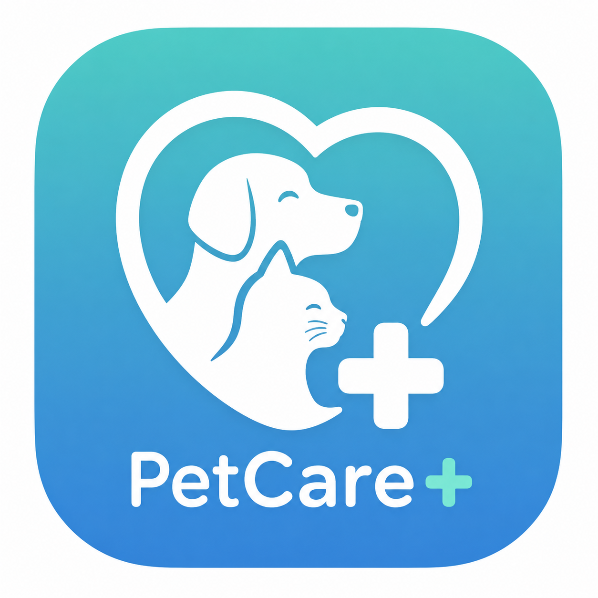

# 🐾 PetCare+ Clinic Hub

A comprehensive web-based platform for veterinary clinics and pet grooming services. Connect pet owners with trusted veterinarians and groomers, manage appointments, and provide quality pet care services.



## ✨ Features

### For Pet Owners
- 🔍 **Find Clinics** - Browse and search veterinary clinics and grooming services
- 📅 **Book Appointments** - Schedule appointments with vets and groomers online
- 🐕 **Pet Management** - Manage multiple pets with medical records
- ⭐ **Rate & Review** - Share experiences and read reviews from other pet owners
- 💬 **Real-time Chat** - Communicate directly with service providers
- 🤖 **AI Assistant** - Get instant pet care advice and recommendations
- ❤️ **Favorites** - Save your preferred clinics and service providers
- 🔔 **Notifications** - Stay updated on appointments and messages

### For Veterinarians
- 📊 **Dashboard** - Manage appointments and view statistics
- 📋 **Medical Records** - Create and manage pet medical records
- 💼 **Profile Management** - Showcase qualifications and services
- ⭐ **Ratings & Reviews** - Build reputation through client feedback
- 🤖 **AI Tools** - Access AI-powered diagnostic assistance

### For Groomers
- 📅 **Appointment Management** - Schedule and track grooming sessions
- 💇 **Service Catalog** - List grooming services and pricing
- ⭐ **Client Reviews** - Receive and display customer feedback
- 📊 **Business Analytics** - Track bookings and revenue

### For Administrators
- 👥 **User Management** - Manage all platform users
- 🏥 **Clinic Management** - Oversee registered clinics and services
- 📊 **Reports & Analytics** - Generate business insights
- ✅ **Verification** - Approve veterinarian and groomer credentials
- 🔧 **System Configuration** - Control platform settings

## 🛠️ Technology Stack

- **Frontend:** HTML5, CSS3, JavaScript
- **Backend:** PHP 8.0+
- **Database:** MySQL 5.7+
- **Libraries:**
  - PHPMailer - Email notifications
  - Groq AI - AI-powered assistance
  - Google Maps API - Location services
- **Server:** Apache (XAMPP/LAMP/WAMP)

## 📋 Requirements

- PHP 8.0 or higher
- MySQL 5.7 or higher
- Apache Web Server
- Composer (for dependencies)
- Modern web browser

## 🚀 Installation

### 1. Clone Repository
```bash
git clone https://github.com/techytropa-prog/petcare-clinic-hub.git
cd petcare-clinic-hub
```

### 2. Install Dependencies
```bash
composer install
```

### 3. Database Setup
1. Create a new MySQL database
2. Import the database schema:
```bash
mysql -u your_username -p your_database < database/COMPLETE_DATABASE_SETUP.sql
```

### 4. Configuration
1. Copy the example secrets file:
```bash
cp includes/local-secrets.example.php includes/local-secrets.php
```

2. Edit `includes/config.php` for production or `includes/local-secrets.php` for local development:
```php
// Database Configuration
define('DB_HOST', 'localhost');
define('DB_NAME', 'your_database_name');
define('DB_USER', 'your_username');
define('DB_PASS', 'your_password');

// App URL
define('APP_URL', 'http://localhost/petcare-clinic-hub');
```

3. (Optional) Configure API keys in `includes/local-secrets.php`:
```php
define('LOCAL_GROQ_API_KEY', 'your_groq_api_key');
define('LOCAL_MAIL_USER', 'your_gmail@gmail.com');
define('LOCAL_MAIL_PASS', 'your_gmail_app_password');
```

### 5. Set Permissions
```bash
chmod -R 755 uploads/
chmod -R 755 logs/
```

### 6. Access the Platform
Open your browser and navigate to:
```
http://localhost/petcare-clinic-hub
```

## 🎯 Demo Accounts

After importing the database, you can use these demo accounts:

### Admin
- Email: `admin@petcareplus.com`
- Password: `admin123`

### Veterinarian
- Email: `vet@example.com`
- Password: `vet123`

### Groomer
- Email: `groomer@example.com`
- Password: `groomer123`

### Pet Owner
- Email: `owner@example.com`
- Password: `owner123`

## 📁 Project Structure

```
petcare-clinic-hub/
├── api/                    # REST API endpoints
├── assets/                 # Static assets (CSS, JS, images)
├── auth/                   # Authentication pages
├── cron/                   # Scheduled tasks
├── dashboard/              # User dashboards
│   ├── admin/             # Admin dashboard
│   ├── owner/             # Pet owner dashboard
│   ├── vet/               # Veterinarian dashboard
│   └── groomer/           # Groomer dashboard
├── database/              # Database schema and seeds
├── includes/              # PHP includes and configuration
├── pages/                 # Public pages
├── uploads/               # User uploaded files
├── vendor/                # Composer dependencies
└── index.php              # Landing page
```

## 🔐 Security Features

- ✅ Password hashing with bcrypt
- ✅ Session management with secure cookies
- ✅ SQL injection prevention (prepared statements)
- ✅ XSS protection
- ✅ CSRF token implementation
- ✅ Role-based access control
- ✅ File upload validation
- ✅ Rate limiting on sensitive endpoints

## 🌐 Production Deployment

### Environment Configuration
1. Switch to production mode in `includes/config.php`:
```php
define('APP_ENV', 'production');
define('APP_URL', 'https://yourdomain.com');
```

2. Update database credentials with production values

3. Disable error display:
```php
error_reporting(0);
ini_set('display_errors', 0);
```

### Cron Jobs Setup
Set up automated tasks in your hosting control panel:

**Check No-Shows (Every 30 minutes):**
```bash
*/30 * * * * php /path/to/petcare-clinic-hub/cron/no_show_checker.php
```

**Check User Inactivity (Daily at 2 AM):**
```bash
0 2 * * * php /path/to/petcare-clinic-hub/cron/inactivity_checker.php
```

## 📧 Email Configuration

For Gmail SMTP:
1. Enable 2-Step Verification in Google Account
2. Generate App Password at https://myaccount.google.com/apppasswords
3. Add credentials to `includes/local-secrets.php`:
```php
define('LOCAL_MAIL_USER', 'your-email@gmail.com');
define('LOCAL_MAIL_PASS', 'your-16-char-app-password');
```

## 🤖 AI Integration

The platform uses Groq AI for:
- Pet care advice and recommendations
- Symptom analysis
- Diagnostic assistance
- General pet health inquiries

Get your API key at: https://console.groq.com

## 🗺️ Google Maps Setup

1. Get API key at: https://console.cloud.google.com/
2. Enable Maps JavaScript API and Places API
3. Add to configuration:
```php
define('GOOGLE_MAPS_KEY', 'your_google_maps_api_key');
```

## 📱 Progressive Web App (PWA)

PetCare+ includes PWA support:
- Installable on mobile devices
- Offline functionality
- Push notifications
- App-like experience

## 🐛 Troubleshooting

### Database Connection Error
- Verify database credentials in `includes/config.php`
- Ensure MySQL service is running
- Check database user permissions

### Email Not Sending
- Verify SMTP credentials
- Check Gmail App Password is correct
- Ensure `MAIL_ENABLED` is set to `true`

### File Upload Issues
- Check `uploads/` directory permissions (755)
- Verify `MAX_FILE_SIZE` in config
- Ensure PHP `upload_max_filesize` is adequate

### Session Problems
- Check PHP session configuration
- Verify browser accepts cookies
- Clear browser cache and cookies

## 🤝 Contributing

Contributions are welcome! Please follow these guidelines:
1. Fork the repository
2. Create a feature branch
3. Commit your changes
4. Push to the branch
5. Open a Pull Request

## 📄 License

This project is licensed under the MIT License - see the LICENSE file for details.

## 👨‍💻 Author

**TechyTropa**
- GitHub: [@techytropa-prog](https://github.com/techytropa-prog)

## 🙏 Acknowledgments

- PHPMailer for email functionality
- Groq for AI capabilities
- Google Maps for location services
- Font Awesome for icons
- All contributors and testers

## 📞 Support

For support, email support@petcareplus.com or open an issue on GitHub.

---

**Made with ❤️ for pets and their humans**
